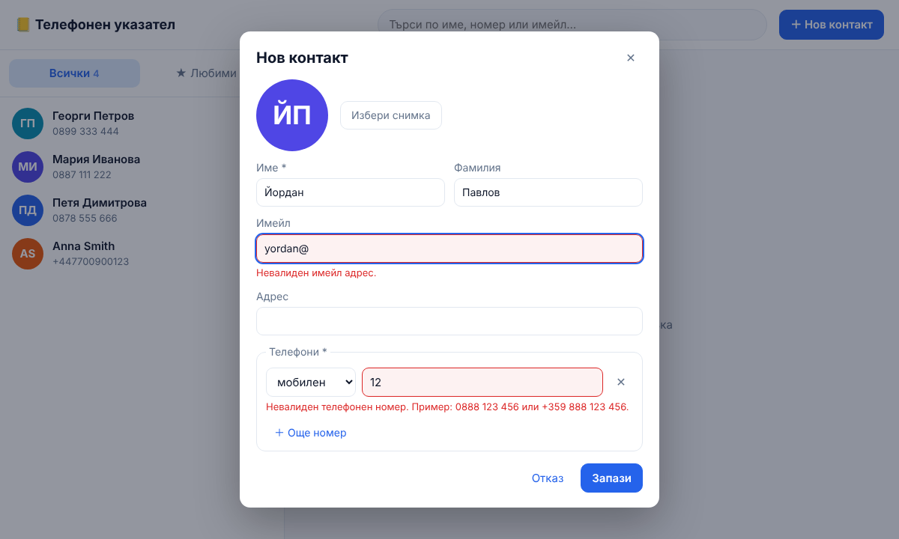

# PhoneBook

[](https://github.com/Daneto123/PhoneBook/actions/workflows/test.yml)

**Телефонен указател** с уеб интерфейс на български: контакти със снимка, няколко номера на контакт, любими и търсене по име, номер или имейл. Сървърът е на Node.js и Express, а данните са в MongoDB или, без никаква настройка, в локален файл.

Проектът е по предмета „Уеб технологии“ във ФМИ (2022). Направен е от **отбор 4: Дейвид, Виктор и Йордан**. Оригиналната версия е запазена непроменена в бранча [`university-2022`](https://github.com/Daneto123/PhoneBook/tree/university-2022).


## Какво може

- **Контакти:** име и фамилия (на кирилица или латиница), имейл, адрес и снимка. Добавят се, **редактират** и изтриват.
- **Няколко номера** на контакт (мобилен, домашен, служебен, друг). Номерът е линк за обаждане и може да се копира с бутон.
- **Номерата се разпознават във всеки запис:** `0888 123 456`, `+359 888 123 456` и `00359888123456` са един и същи номер. Показва се като `0888 123 456`, а един номер не може да се въведе два пъти. Приемат се и чужди (`+44 …`) и кратки (`112`) номера.
- **Любими** със ★ и отделен раздел за тях.
- **Търсене** по име, фамилия, имейл, адрес или част от номер (`0887`, `359887`). Не зависи от малки и главни букви, включително на кирилица. С `/` се отива в полето за търсене.
- **Снимки:** изрязват се квадратно и се смаляват в браузъра до 256×256 px, така че дори 10 MB снимка от телефон става около 30 KB. Пазят се в самата база, без отделна папка за качвания.
- **Ясни грешки** под всяко поле във формата.
- **Работи и на телефон**, има и тъмна тема.

<p>
  
  
</p>

## Пускане

Нужен е [Node.js](https://nodejs.org) 20 или по-нов.

```bash
git clone https://github.com/Daneto123/PhoneBook.git
cd PhoneBook
npm install
npm start
```

Отворете http://localhost:3000. Без настройки данните се пазят във файла `data/contacts.json`.

**С MongoDB:** копирайте `.env.example` като `.env` и попълнете `DBCONNECTION`. Може с безплатен клъстер в [MongoDB Atlas](https://www.mongodb.com/atlas) или с локална MongoDB. Файлът `.env` е в `.gitignore` и паролата не се качва в GitHub.

**С Docker** (указателят и MongoDB заедно):

```bash
docker compose up -d
```

**Деплой:** проектът работи на всеки хостинг за Node.js, например Render, Railway или Fly.io, с `DBCONNECTION` към MongoDB Atlas. Не се използва диск за качвания, а всички адреси в страницата са относителни, така че не е нужно нищо да се сменя.

## API

Документацията е на **http://localhost:3000/api-docs** (Swagger).

| Метод | Адрес | Действие |
|---|---|---|
| `GET` | `/api/contacts?search=&favorites=true` | всички контакти, по азбучен ред |
| `POST` | `/api/contacts` | нов контакт |
| `GET` | `/api/contacts/:id` | един контакт |
| `PATCH` | `/api/contacts/:id` | промяна (само изпратените полета): име, имейл, телефони, `favorite`, `avatar` |
| `DELETE` | `/api/contacts/:id` | изтриване |
| `POST` | `/api/contacts/:id/phones` | добавя номер |
| `DELETE` | `/api/contacts/:id/phones/:number` | премахва номер (в какъвто и да е запис) |
| `GET` | `/api/contacts/:id/avatar` | снимката |

Грешките връщат правилен код (400, 404, 413) и съобщение на български за всяко поле:

```json
{ "error": "Невалиден имейл адрес.", "fields": { "email": "Невалиден имейл адрес." } }
```

## Сигурност

- Снимките се проверяват по съдържанието на файла, не по името или по това какво твърди браузърът. Приемат се само JPEG, PNG и WebP до 300 KB.
- Всичко от потребителите се показва като текст, без `innerHTML`, така че HTML в име не може да се изпълни.
- Сигурни HTTP заглавия (Helmet, Content Security Policy).

## Тестове

```bash
npm test
```

Тестовете минават целия API без външни услуги: създаване, валидиране, търсене, любими, телефони, снимки, грешни данни и изтриване, плюс запис във файл и четене след рестарт. В GitHub Actions същите тестове се пускат и срещу **истинска MongoDB**, на Node 20, 22 и 24.

## Структура

```
server/
  index.js         старт: MongoDB или файл според .env
  app.js           Express приложението
  contacts.js      API за контактите
  validation.js    проверка на имена, имейли, номера и снимки
  openapi.js       документацията за /api-docs
  store/           къде се пазят данните: mongoStore, fileStore, memoryStore
public/            уеб страницата (HTML, CSS, JavaScript, без framework)
tests/             тестове (node:test + supertest)
docs/              снимки и оригиналната диаграма
```
